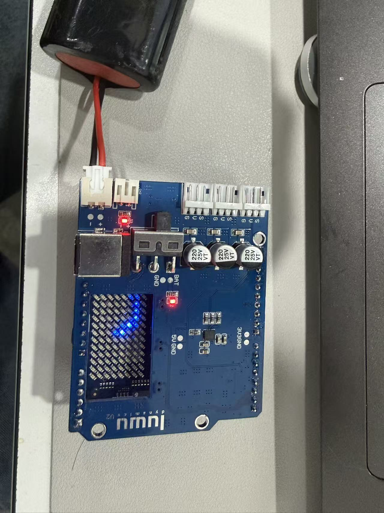

# ArduinoUnoQ PCBA — V1.1

**English** · [简体中文](README_CN.md)

> [!WARNING]
> **⚠️ CHARGING SAFETY — POWER SWITCH OFF**
>
> **Always turn the power switch OFF before charging.** 
> **Keep it OFF throughout charging.**
>
> **If the adapter indicator turns green but the system will not power on:**
>
> If, after extended charging, the adapter indicator turns green but the system will not power on after the adapter is unplugged and the power switch is turned ON, check the battery pack's output with a multimeter.
>
> **The recovery procedure below applies only to a 2-series-cell lithium-ion pack rated 7.4 V nominal / 8.4 V maximum. Do not use this procedure for deeply discharged or damaged cells.**
>
> 1. Turn the power switch **OFF**, unplug the adapter, and disconnect the battery pack from the PCB.
> 2. Use a regulated, **current-limited** external supply at **7.4 V or 8.4 V**, with a **1 A or 2 A current limit** that does not exceed the pack's specified charging current. Alternatively, use an adjustable DC bench supply with the **voltage limit set to 7.4 V and the current limit set to 1 A**. These are voltage and current limits, not a requirement to force a constant 1 A into the battery. An adapter's nameplate current rating alone is not a controlled charging current.
> 3. With the recovery supply switched OFF, connect its positive and negative leads to the battery pack's matching **protected charging terminals**, checking polarity carefully. **Do not bypass the protection board or connect directly to bare cells.** Enable the supply for **10–20 seconds** while monitoring the pack to attempt to release the protection cutoff. Then switch the supply OFF and disconnect it. Stop if there is abnormal heating or any other abnormal behavior. Confirm that the pack output has recovered; if it remains at 0 V, stop and contact the battery supplier or hello@xgorobot.com rather than repeating the attempt.
> 4. Once the output has recovered and the pack is operating normally, reconnect the battery to the PCB and reconnect the compatible charging adapter to resume normal charging. **Keep the power switch OFF throughout charging.**

> [!WARNING]
> **When testing and tuning servos, avoid stalling them as much as possible.**

> [!WARNING]
> **The boards shown in the videos and images differ from the project files. Use the project files as the authoritative reference for design and fabrication.**

> [!IMPORTANT]
> **Current version: V1.1 · Published: 2026-10-26.** This directory contains the V1.1 files. [Previous files and historical instructions](archive/pre-V1.1/) remain available in the archive.

## Test videos and board photograph

### Reverse connection foolproof test

https://github.com/user-attachments/assets/4a6c70d0-b336-4885-abd3-cd6997a62fa3

A reverse-connection test recording showing the test procedure and board response under the demonstrated connection conditions.

### Servo Stall Test

https://github.com/user-attachments/assets/ed0dd218-92c2-43e2-9127-683b2c6dd4ab

A servo stall test recording showing the test procedure and system response when servo movement is obstructed.

### Board photograph

The photograph shows the board, power connection, servo connectors and indicator LEDs as a visual reference for connector locations.

## V1.1 files

| Path | Contents |
| --- | --- |
| [ArduinoUnoQV1.1.SchDoc](ArduinoUnoQV1.1.SchDoc) | Altium schematic source |
| [BOM/ArduinoUnoQV1.1.xlsx](BOM/ArduinoUnoQV1.1.xlsx) | Board BOM |
| [CoordinatePoint/](CoordinatePoint/) | Pick-and-place coordinates |
| [ProductionDocuments/](ProductionDocuments/) | Fabrication notes, Gerber, drill files and export reports |
| [SilkscreenLayout/ArduinoUnoQV1.1.pdf](SilkscreenLayout/ArduinoUnoQV1.1.pdf) | Silkscreen layout reference |
| [DWG/ArduinoUnoQV1.1.DWG](DWG/ArduinoUnoQV1.1.DWG) | DWG drawing |
| [Step/ArduinoUnoQV1.1.step](Step/ArduinoUnoQV1.1.step) | STEP 3D model |

This publication preserves the supplied files and directory structure. A V1.1 `.PcbDoc` file was not supplied. The archived PCB source is not a V1.1 file and must not be mixed into this revision. Detailed circuit changes and backward compatibility notes were not supplied with this package; test videos and a board photograph are available above.

## Previous version

- [Previous files and original README](archive/pre-V1.1/)
- [Repository snapshot before V1.1](https://github.com/LuwuDynamics/xgoduck_hardware/tree/hardware-pre-v1.1/PCBA)

All eight previous PCBA files are preserved unchanged. `pre-V1.1` identifies the archived snapshot, not an assigned historical version number. The 2026-10-02 U3/U4/U5 wiring notice remains in the archived README and applies only to the old-board conditions described there, not automatically to V1.1.

## PCB supplier contact

Luwu Dynamics' partner PCB supplier is **深圳诚和欣科技有限公司**. Developers can contact the supplier below about PCB manufacturing for this project.

| Item | Details |
| --- | --- |
| Company | 深圳诚和欣科技有限公司 |
| Contact | Liu Xiaoya |
| Phone | +86 13537846596 |
| Email | [liu@chxpcba.com](mailto:liu@chxpcba.com) |
| Address | Area 1, 2nd Floor, Building 3, Hongdu Industrial Park, Lezhujiao, Xixiang, Bao'an District, Shenzhen, China |

When enquiring, mention **XGO-Duck / ArduinoUnoQ expansion board** and include the design revision, quantity and requirements to help the supplier prepare a quotation.
