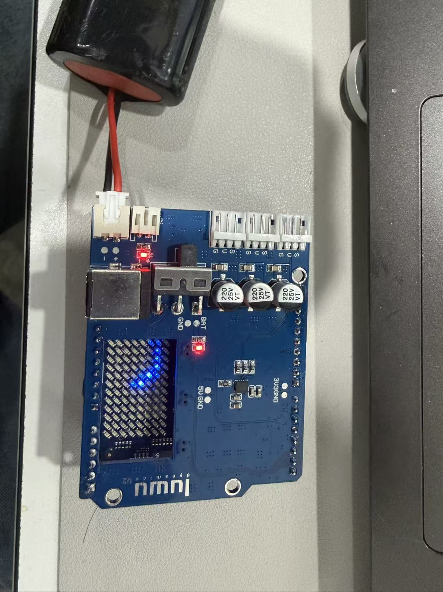

# ArduinoUnoQ PCBA — V1.1

> [!IMPORTANT]
> **当前版本：V1.1 · 发布日期：2026-10-26。** 本目录默认展示 V1.1 资料；[旧版完整文件及历史说明](archive/pre-V1.1/)已归档保留。
>
> **Current version: V1.1 · Published: 2026-10-26.** This directory contains the V1.1 files. [Previous files and historical instructions](archive/pre-V1.1/) remain available in the archive.

## 测试视频与实物展示 / Test videos and board photograph

### 反接防呆测试 / Reverse connection foolproof test

[打开或下载视频 / Open or download video](https://raw.githubusercontent.com/LuwuDynamics/xgoduck_hardware/master/media/pcba-v1.1/Reverse%20connection%20foolproof%20test.mp4)

反接防呆测试视频，用于记录反向连接场景下的测试过程及板卡响应。

A reverse-connection test recording showing the test procedure and board response under the demonstrated connection conditions.

### 舵机堵转测试 / Servo Stall Test

[打开或下载视频 / Open or download video](https://raw.githubusercontent.com/LuwuDynamics/xgoduck_hardware/master/media/pcba-v1.1/Servo%20Stall%20Test.mp4)

舵机堵转测试视频，用于记录舵机运动受阻时的测试过程及系统响应。

A servo stall test recording showing the test procedure and system response when servo movement is obstructed.

### 板卡实物照片 / Board photograph

实物照片展示板卡外观、供电连接、舵机接口及指示灯，便于对照识别接口位置。

The photograph shows the board, power connection, servo connectors and indicator LEDs as a visual reference for connector locations.

## V1.1 文件 / Files

| 文件 / Path | 内容 / Contents |
| --- | --- |
| [ArduinoUnoQV1.1.SchDoc](ArduinoUnoQV1.1.SchDoc) | 原理图源文件 / Altium schematic source |
| [BOM/ArduinoUnoQV1.1.xlsx](BOM/ArduinoUnoQV1.1.xlsx) | 板卡物料清单 / Board BOM |
| [CoordinatePoint/](CoordinatePoint/) | 元件放置坐标 / Pick-and-place coordinates |
| [ProductionDocuments/](ProductionDocuments/) | 生产工艺、Gerber、钻孔及导出报告 / Fabrication notes, Gerber, drill files and export reports |
| [SilkscreenLayout/ArduinoUnoQV1.1.pdf](SilkscreenLayout/ArduinoUnoQV1.1.pdf) | 丝印布局参考 / Silkscreen layout reference |
| [DWG/ArduinoUnoQV1.1.DWG](DWG/ArduinoUnoQV1.1.DWG) | DWG 图纸 / DWG drawing |
| [Step/ArduinoUnoQV1.1.step](Step/ArduinoUnoQV1.1.step) | STEP 三维模型 / STEP 3D model |

本次按提供的文件与目录原样发布；未包含 V1.1 的 `.PcbDoc` 文件。旧版归档中的 PCB 源文件不属于 V1.1，不能与本目录的新资料混作同一版本。具体电路改动和旧版兼容性说明尚未随本批文件提供；测试视频及实物照片见上方。

This publication preserves the supplied files and directory structure. A V1.1 `.PcbDoc` file was not supplied. The archived PCB source is not a V1.1 file and must not be mixed into this revision. Detailed circuit changes and backward compatibility notes were not supplied with this package; test videos and a board photograph are available above.

## 旧版归档 / Previous version

- [旧版文件及原说明 / Previous files and original README](archive/pre-V1.1/)
- [归档前的仓库快照 / Repository snapshot before V1.1](https://github.com/LuwuDynamics/xgoduck_hardware/tree/hardware-pre-v1.1/PCBA)

归档保留发布 V1.1 前的全部 8 个 PCBA 文件，原始内容不变。`pre-V1.1` 表示旧版快照，并不另行认定旧版正式版本号。2026-10-02 的 U3/U4/U5 换线说明保留在旧版 README 中，仅针对其中说明的旧板情况，不应直接套用于 V1.1。

All eight previous PCBA files are preserved unchanged. `pre-V1.1` identifies the archived snapshot, not an assigned historical version number. The 2026-10-02 U3/U4/U5 wiring notice remains in the archived README and applies only to the old-board conditions described there, not automatically to V1.1.

## 合作 PCB 供应商 / PCB supplier contact

**深圳诚和欣科技有限公司**是陆吾智能的合作 PCB 供应商。开发者如需咨询本项目 PCB 制作相关事宜，可通过以下方式联系。

Developers can contact Luwu Dynamics' partner PCB supplier below about PCB manufacturing for this project.

| 项目 / Item | 信息 / Details |
| --- | --- |
| 公司 / Company | 深圳诚和欣科技有限公司 |
| 联系人 / Contact | 刘晓亚 / Liu Xiaoya |
| 电话 / Phone | +86 13537846596 |
| 邮箱 / Email | [liu@chxpcba.com](mailto:liu@chxpcba.com) |
| 地址 / Address | 深圳市宝安区西乡簕竹角鸿都工业园 3 栋 2 楼 1 区 / Area 1, 2nd Floor, Building 3, Hongdu Industrial Park, Lezhujiao, Xixiang, Bao'an District, Shenzhen, China |

咨询时建议注明 **XGO-Duck / ArduinoUnoQ 扩展板**，并提供所用工程版本、制作数量及需求，便于沟通与报价。

When enquiring, mention **XGO-Duck / ArduinoUnoQ expansion board** and include the design revision, quantity and requirements to help the supplier prepare a quotation.
