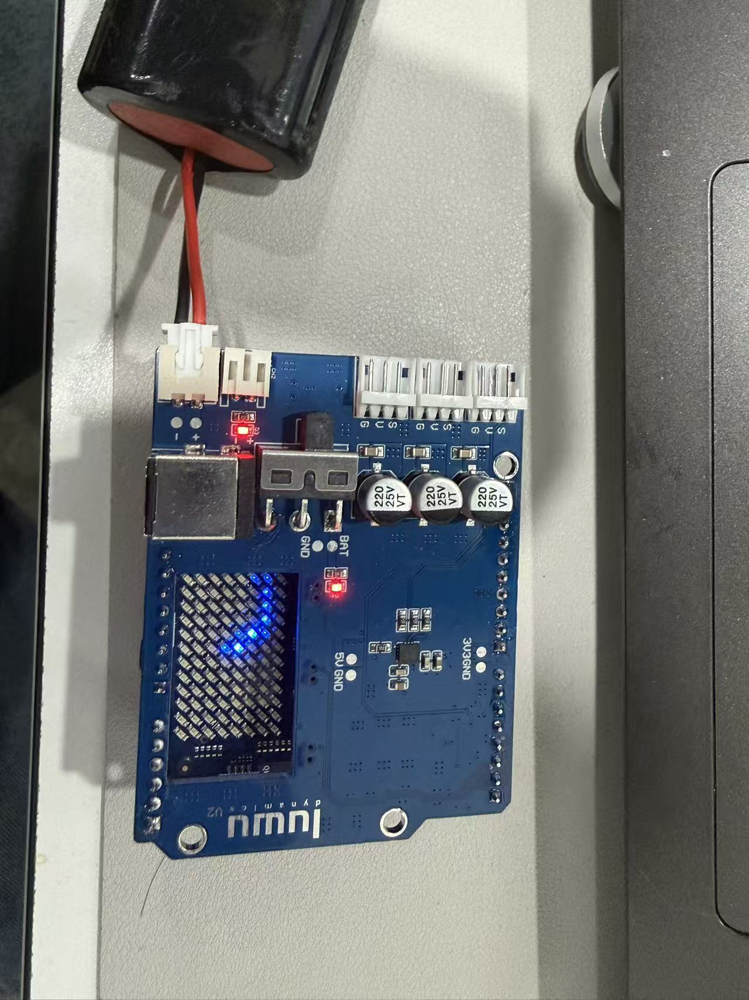

# ArduinoUnoQ PCBA — V1.1

[English](README.md) · **简体中文**

> [!WARNING]
> **⚠️ 充电安全——务必关闭电源开关**
>
> **充电前务必关闭电源开关。** 
> **整个充电过程中，开关必须保持关闭。**
>
> **如果电源适配器指示灯变绿，但系统仍无法上电：**
>
> 如果长时间充电后，适配器指示灯变绿，但拔掉适配器并打开电源开关后，系统仍无法启动，请使用万用表检查电池包的输出电压。
>
> **以下恢复步骤仅适用于标称电压为 7.4V、最高电压为 8.4V 的两串锂离子电池包。不要对严重过放或损坏的电芯使用此方法。**
>
> 1. **关闭电源开关**，拔掉适配器，并将电池包从 PCB 主板上断开。
> 2. 使用输出为 **7.4V 或 8.4V**、具有稳压和**限流功能**的外接电源，将电流上限设为 **1A 或 2A**，且不得超过电池包规定的充电电流。也可以使用可调直流稳压电源，将**电压上限设为 7.4V，电流上限设为 1A**。这些是电压和电流的限制值，并不意味着必须强制向电池输入恒定的 1A 电流。适配器铭牌上标注的额定电流，本身不等于受控的充电电流。
> 3. 在外接恢复电源关闭的状态下，将其正负极分别连接到电池包对应的、**经过保护板保护的充电端子**，仔细核对极性。**不要绕过保护板，也不要直接连接裸电芯。**开启电源 **10–20 秒**，期间监测电池包状态，尝试解除保护板的输出切断状态。随后关闭并断开外接电源。如出现异常发热或其他异常情况，应立即停止。确认电池包输出电压已恢复；如果仍为 0V，请停止操作，联系电池供应商或 hello@xgorobot.com，不要反复尝试。
> 4. 输出电压恢复且电池包工作正常后，将电池重新连接到 PCB 主板，再接入匹配的充电适配器，恢复正常充电。**整个充电过程中，电源开关必须保持关闭。**

> [!WARNING]
> **调试舵机尽量避免堵转。**

> [!WARNING]
> **视频及图片中的板卡与工程文件存在差异，实际设计与制作请以工程文件为准。**

> [!IMPORTANT]
> **当前版本：V1.1 · 发布日期：2026-10-26。** 本目录默认展示 V1.1 资料；[旧版完整文件及历史说明](archive/pre-V1.1/)已归档保留。

## 测试视频与实物展示

### 反接防呆测试

https://github.com/user-attachments/assets/4a6c70d0-b336-4885-abd3-cd6997a62fa3

反接防呆测试视频，用于记录反向连接场景下的测试过程及板卡响应。

### 舵机堵转测试

https://github.com/user-attachments/assets/ed0dd218-92c2-43e2-9127-683b2c6dd4ab

舵机堵转测试视频，用于记录舵机运动受阻时的测试过程及系统响应。

### 板卡实物照片

实物照片展示板卡外观、供电连接、舵机接口及指示灯，便于对照识别接口位置。

## V1.1 文件

| 文件 | 内容 |
| --- | --- |
| [ArduinoUnoQV1.1.SchDoc](ArduinoUnoQV1.1.SchDoc) | 原理图源文件 |
| [BOM/ArduinoUnoQV1.1.xlsx](BOM/ArduinoUnoQV1.1.xlsx) | 板卡物料清单 |
| [CoordinatePoint/](CoordinatePoint/) | 元件放置坐标 |
| [ProductionDocuments/](ProductionDocuments/) | 生产工艺、Gerber、钻孔及导出报告 |
| [SilkscreenLayout/ArduinoUnoQV1.1.pdf](SilkscreenLayout/ArduinoUnoQV1.1.pdf) | 丝印布局参考 |
| [DWG/ArduinoUnoQV1.1.DWG](DWG/ArduinoUnoQV1.1.DWG) | DWG 图纸 |
| [Step/ArduinoUnoQV1.1.step](Step/ArduinoUnoQV1.1.step) | STEP 三维模型 |

本次按提供的文件与目录原样发布；未包含 V1.1 的 `.PcbDoc` 文件。旧版归档中的 PCB 源文件不属于 V1.1，不能与本目录的新资料混作同一版本。具体电路改动和旧版兼容性说明尚未随本批文件提供；测试视频及实物照片见上方。

## 旧版归档

- [旧版文件及原说明](archive/pre-V1.1/)
- [归档前的仓库快照](https://github.com/LuwuDynamics/xgoduck_hardware/tree/hardware-pre-v1.1/PCBA)

归档保留发布 V1.1 前的全部 8 个 PCBA 文件，原始内容不变。`pre-V1.1` 表示旧版快照，并不另行认定旧版正式版本号。2026-10-02 的 U3/U4/U5 换线说明保留在旧版 README 中，仅针对其中说明的旧板情况，不应直接套用于 V1.1。

## 合作 PCB 供应商

**深圳诚和欣科技有限公司**是陆吾智能的合作 PCB 供应商。开发者如需咨询本项目 PCB 制作相关事宜，可通过以下方式联系。

| 项目 | 信息 |
| --- | --- |
| 公司 | 深圳诚和欣科技有限公司 |
| 联系人 | 刘晓亚 |
| 电话 | +86 13537846596 |
| 邮箱 | [liu@chxpcba.com](mailto:liu@chxpcba.com) |
| 地址 | 深圳市宝安区西乡簕竹角鸿都工业园 3 栋 2 楼 1 区 |

咨询时建议注明 **XGO-Duck / ArduinoUnoQ 扩展板**，并提供所用工程版本、制作数量及需求，便于沟通与报价。
