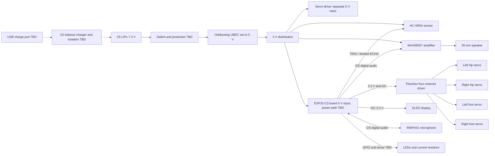

# Cece prototype wiring plan — do not assemble as a final schematic

## Components and power

- Battery: Dualsky DSBXP05502ULT, 2S 550 mAh LiPo, advertised 52 x 31 x 12 mm,
  JST discharge connector. Ordered with Hobbywing UBEC-5A-V2-Air. Verify battery
  balance connector and dimensions including wire exits on arrival.
  https://www.supercheaphobbies.com.au/store/550mah-dualsky-lipo-battery-with-connector-p-51186.html
- Separate proper 2S LiPo balance charger with matched cell chemistry, current,
  connectors and isolation is REQUIRED. USB-C socket, charger selection,
  balance wiring and charge-while-running behavior remain unresolved. Do not
  connect USB power directly to this battery or assume UBEC charges it.
- Battery -> appropriately rated switch/protection -> UBEC input; set UBEC to
  5 V and verify with meter before connecting any loads. 5 V rail powers the
  4 servo outputs, sensor and amplifier; common ground joins logic and power.
  The PiicoDev module uses a separate 5 V servo supply and 3.3 V logic rail.
  Check its exact circuit and input connector before connecting it. Do not
  feed raw battery voltage to the ESP32, servo board or other 5 V electronics.
- ESP32 Super Mini powered by an appropriate 5 V input only after confirming
  its exact board's power path and USB isolation; avoid USB/UBEC backfeeding.
  Its 3.3 V pin supplies logic, microphone and OLED, subject to regulator
  capacity and OLED requirements. ESP32 3.3 V and all 5 V grounds common.
- Four SG90 servo plugs -> driver sockets labelled 1..4 (PCA9685 channels 3,2,1,0 respectively), polarity per silk, assign
  left hip, right hip, left ankle, right ankle after mechanical calibration.
- Audio speaker connects across amplifier + and - outputs only; neither
  speaker terminal is ground. Verify connector and pin labels on both parts.
- HC-SR04 Vcc to regulated 5 V, GND to GND. Echo must be reduced to safe
  3.3 V logic: suggested divider 1k from ECHO to GPIO, 1k GPIO to GND;
  verify input high threshold and measure, never apply 5 V to ESP32 GPIO.
  TRIG is 3.3 V output; verify this particular sensor triggers reliably;
  a 3.3-to-5 V buffer may be required.

## Proposed pin allocation — check Super Mini pinout before use

| ESP32-C3 GPIO | Net | Other end |
|---|---|---|
| 0 | I2C SDA | Servo driver SDA and OLED SDA at 3.3 V |
| 1 | I2C SCL | Servo driver SCL and OLED SCL at 3.3 V |
| 3 | I2S BCLK | Microphone SCK and amplifier BCLK |
| 4 | I2S word select | Microphone WS and amplifier LRC |
| 5 | I2S DIN | Microphone SD output |
| 6 | I2S DOUT | Amplifier DIN |
| 7 | Ultrasonic TRIG | HC-SR04 TRIG (3.3 V, verify) |
| 10 | Ultrasonic ECHO | HC-SR04 ECHO via divider |
| 20 | LED group | transistor gate/base circuit TBD; not directly 5 LEDs |

GPIO2, 8 and 9 are strapping pins; 18 and 19 are USB. GPIO20/21 may be
labelled RX/TX and can affect serial use. GPIO0/1 assignment and 3.3 V I2C
pull-ups must be checked on actual modules. The selected Adafruit 4741 SSD1327 OLED defaults to I2C 0x3D (0x3C if its address jumper is bridged); the PiicoDev socket labels 1,2,3,4 map to chip channels 3,2,1,0. The default PiicoDev address is
0x44; verify OLED address and ensure no duplicate pull-up or 5 V pull-ups.
ESP32-C3 supports full-duplex standard I2S with shared clocks in current ESP-IDF.
The firmware has unverified microphone and test-tone diagnostics; voice streaming
and physical audio validation are still outstanding. See
https://docs.espressif.com/projects/esp-idf/en/release-v6.0/esp32c3/api-reference/peripherals/i2s.html

## Missing or unverified before ordering the rest

2S compatible charger/USB input and balance/protection design, servo driver power
cable, UBEC/battery adapter and switch, GPIO divider resistors, LED transistor
and resistors, perfboard wires/connectors, speaker adapter, M2 mounting
hardware, battery retention and isolation. No confirmed space inside the body.
The OLED is a separate supplier item, not present in the Core cart. The Core
cart was last observed before order; cart contents do not mean items purchased.

## Connection diagram (concept only)

All grounds are common on the operating power and logic circuits. This diagram
is not the final charge circuit or a construction-ready electrical schematic.
USB data/programming and charging are separate functions. Physical connector
pinouts and the detailed grounding, fusing and shutdown scheme remain to be
specified and verified.
